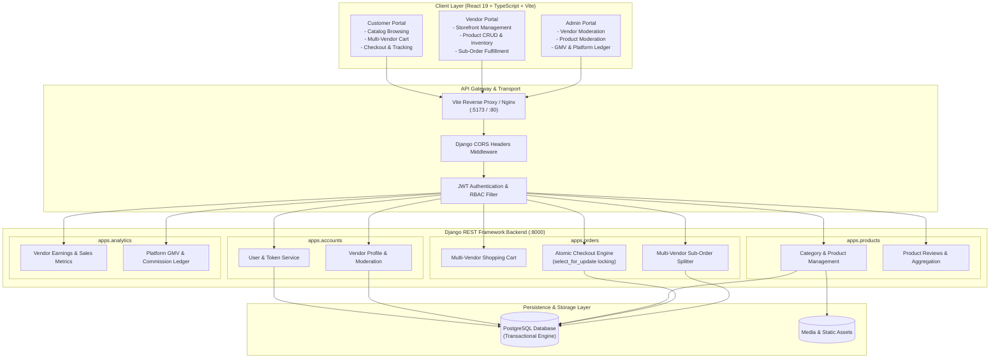
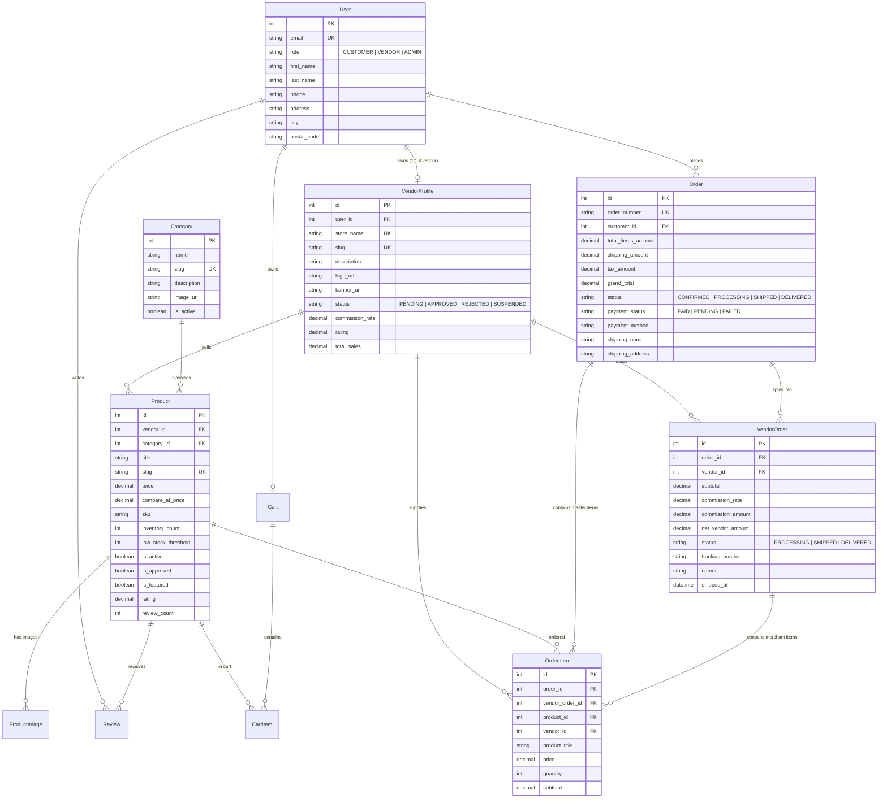
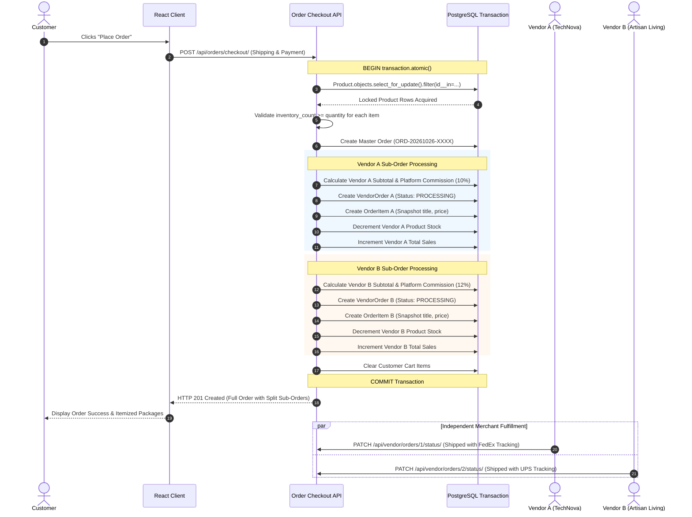

# Modern Shop Multi-Vendor Architecture Specification

This document provides a comprehensive technical architecture and data design specification for the **Modern Shop Multi-Vendor E-Commerce Marketplace**, developed with React, Vite, TypeScript, Django REST Framework (DRF), and PostgreSQL.

---

## 1. System Architecture Overview

The system is designed as a decoupled, multi-tiered web architecture adhering to the 12-Factor App methodology.

---

## 2. Entity-Relationship Diagram (ERD)

The database schema models the multi-vendor marketplace with explicit order splitting, snapshot preservation, and vendor ledger calculations.

---

## 3. Multi-Vendor Transactional Order Splitting Lifecycle

When a customer completes checkout with items from multiple distinct merchants, the system executes an atomic transaction with concurrency locks.

---

## 4. Security & Role-Based Access Control (RBAC)

1. **Authentication:**
   - Stateless JWT authentication via `djangorestframework-simplejwt`.
   - Access tokens stored in client browser storage and passed in HTTP header: `Authorization: Bearer <token>`.
2. **Server-Side Permission Matrices:**
   - `IsAdminUserRole`: Restricts vendor approvals, category administration, and platform-wide order audits.
   - `IsVendorUser`: Ensures only approved vendors can access vendor APIs.
   - `IsVendorOwnerOrReadOnly`: Verifies that vendors can modify only products and fulfillment orders that belong to their own store.
3. **Transactional Integrity:**
   - Database row-level locking via `select_for_update()` inside `transaction.atomic()` blocks prevents overselling and race conditions during high-concurrency checkouts.
